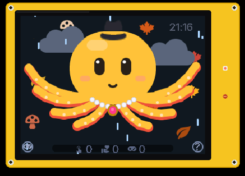

# Cheap Yellow Companion

🇬🇧 [English version](README.md)

**Yellow** ist ein kleiner, stummer Begleiter für Schreibtisch oder Nachttisch auf dem *Cheap Yellow Display*
(ESP32-2432S028R, 320×240, resistiver Touch, RGB-LED, kein PSRAM), gebaut mit **ESPHome + LVGL 9**, spricht **MQTT**,
mit oder ohne **Home Assistant**.

Yellow kann nicht sprechen und weiß das – er hält Pappschilder hoch, schneidet Grimassen, winkt und ist ein bisschen
neidisch auf den Sprachassistenten, der reden darf. Drei Figuren: **Okti** (ein Wende-Oktopus, gelb und froh oder rot
und grummelig), ein **Fuchs** (mutig, etwas frech) und ein kleiner **Roboter**.

  
  
  

Echte Bildschirmausgabe, Pixel für Pixel vom Gerät aufgenommen. Mehr in der
<a href="docs_de/galerie.md">Galerie</a> – aber nicht alles, den Rest selbst entdecken.

## Funktionen

- Animierte Figuren nur aus LVGL-Formen, Bögen und Linien (keine Bitmaps): atmen, blinzeln, schauen dem Finger nach,
  Arme/Schwanz greifen, halten Schilder und winken. Regler für Stimmung, Anspannung und Energie.
- Touch: antippen, wischen = streicheln, halten für die Infos des Tages, 4× schnell tippen (mag er nicht), **?** öffnet
  die Hilfe, der Gamepad-Knopf (unten links) startet ein Spiel.
- **Spiele:** Reaktionstest, Tic-Tac-Toe (er schummelt, wenn er verliert), Simon Says.
- **Post und Liebesbriefe:** Nachrichten warten im Umschlag, bis jemand Yellow antippt; Lesebestätigung zurück.
- **Fragen** mit zwei Antwortknöpfen.
- Gesten, Requisiten, Special Moves je Figur (Tintenwolke, Mäuselsprung, Roboter-Glitch, Jonglieren …), Faustgruß.
- **Anlässe und Jahreszeiten** mit Hintergrund-Deko und Hüten; Wetteransicht; Matrix-Regen.
- Nachtregeln: im dunklen Raum reagiert Yellow nie; Antippen zeigt eine ganz schwache Uhr. Uhr-Ansicht im Querformat
  mit Wecker, nächstem Termin, Wetter und Raumklima.
- **Netzstatus:** rotes Symbol ohne WLAN (antippen → WLAN-Dialog mit Netzliste und Bildschirmtastatur), orange, wenn
  der MQTT-Server oder das Internet fehlt.
- **Telemetrie und Aktivitätsprotokoll** (MQTT, retained), **Sprüche aus der Ferne** (eigene Liste, auf dem Gerät
  gespeichert).
- **Deutsch oder Englisch**, beim Kompilieren gewählt (`language: de|en`).
- Optional: **zusammen mit einem Sprachassistenten** (Home Assistant Voice), siehe [docs_de/nabu.md](docs_de/nabu.md).

Die vollständige Liste mit der Version, seit der es jede Funktion gibt: [docs_de/FEATURES.md](docs_de/FEATURES.md).

## Profile

| Paket | Zweck |
|---|---|
| `yellow-base.yaml` | Figur, Display, Touch, Spiele, Hilfe, WLAN-Dialog (immer) |
| `yellow-mqtt.yaml` | Befehle, Daten, Ereignisse, Telemetrie per MQTT (immer) |
| `yellow-home.yaml` | **Zuhause:** lokaler Broker ohne TLS, Zeit von Home Assistant, ESPHome-API für OTA und Logs |
| `yellow-mobile.yaml` | **Unterwegs:** eigener öffentlicher Broker mit TLS, SNTP, läuft auch offline weiter |
| `yellow-nabu.yaml` | Optional: Yellow schaut zum LED-Ring des Sprachassistenten und weiß, wo er steht |
| `yellow-screenshot.yaml` | Optional, nur zum Fotografieren: pixelgenaue Screenshots per MQTT (`tools/screenshot.py`) |
| `board-cyd.yaml` | Hardware-Paket für den ESP32-2432S028R |

## Sprache

Alle Bildschirmtexte stehen in `esphome/lang/<sprache>.h`, Entitätsnamen und die wenigen YAML-Texte in
`esphome/lang/<sprache>.yaml`. In der Gerätedatei die Substitution `language: de` setzen (Standard ist `en`).
Home Assistant bildet die Entity-IDs aus den Entitätsnamen, ein **Sprachwechsel ergibt also neue Entity-IDs**;
Automationen danach anpassen oder die Entity-IDs umbenennen. Eine weitere Sprache = ein weiteres Dateipaar mit
denselben Schlüsseln.

## MQTT-Themen (`yellow/<gerät>/…`)

Die Schnittstelle ist englisch, unabhängig von der Sprache auf dem Bildschirm. Die vollständige Liste der Aktionen,
Felder und Werte steht in der [englischen README](README.md#mqtt-topics-yellowdevice).

- `command` – JSON-Befehl, z. B. `{"action": "message", "text": "Hallo!", "wait": true}`
- `data/<name>` (retained) – occasion, alarm, appointment, notice, weather, weather_condition, outdoor_temp,
  room_temp, room_humidity, sayings, greeting (Zusatzzeile für den ersten Tipp des Tages), progress (beim Halten als Letztes); Ereignisse ohne retain: doorbell, nabu_ring
- `event` – JSON vom Gerät, `type`: read, answer, game, petted, timer_off
- `telemetry` (retained), `status` online/offline (retained, Last Will)

## Installation

1. Dieses Repo in den ESPHome-Konfigurationsordner klonen (`…/esphome/cheap-yellow-companion`).
2. `esphome/example-home.yaml` daneben kopieren (nach `…/esphome/`), Substitutionen (auch `language: de`) und
   Secrets setzen, flashen.
3. In Home Assistant: ein MQTT-Broker (z. B. das Mosquitto-Add-on) mit einem eigenen Benutzer für Yellow, dann die
   Blueprints aus [docs_de/homeassistant.md](docs_de/homeassistant.md).

## Home Assistant

Einrichtung, Entitäten, Sprache und alle Blueprints mit Import-Knöpfen: **[docs_de/homeassistant.md](docs_de/homeassistant.md)**.
Blueprints bisher: Daten senden (Wetter, Wecker, Termin, Raumklima), Türklingel, LED-Ring des Sprachassistenten,
Lesebestätigung, Nachrichten-Skript. Yellow als Dashboard-Karte (WebAssembly): **[docs_de/card.md](docs_de/card.md)**. Alles andere: einen JSON-Befehl an `yellow/<gerät>/command` schicken (siehe oben).

## Stand

0.2.0 – läuft täglich auf einem Nachttisch-Display. Die Home-Assistant-Seite (Blueprints) wird gerade verallgemeinert.
Ideen und Pläne stehen in den Issues, Änderungen im [CHANGELOG.md](CHANGELOG.md) (englisch).

## Lizenz

MIT
