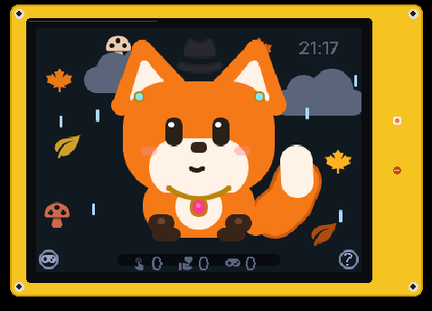

# Cheap Yellow Companion

**Yellow** is a small, mute desk/bedside companion for the *Cheap Yellow Display* (ESP32-2432S028R, 320×240, resistive
touch, RGB LED, no PSRAM), built with **ESPHome + LVGL 9** and talking **MQTT**, with or without **Home Assistant**.

Yellow cannot talk and knows it – he holds up cardboard signs, pulls faces, waves and is a little jealous of the voice
assistant that is allowed to speak. Three characters: **Okti** (a reversible octopus, yellow and happy or red and
grumpy), a **fox** (brave, a bit cheeky) and a small **robot**.

  
  
  

Real screen output, recorded pixel by pixel from the device. More in the
<a href="docs/galerie.md">gallery</a> – but not everything, find the rest yourself.

> The on-screen texts are German for now (translations: #1).

## Features

- Animated characters drawn from LVGL shapes, arcs and lines only (no bitmaps): breathing, blinking, looking at your
  finger, arms/tail that reach, hold signs and wave. Mood, tension and energy sliders.
- Touch: tap, swipe to pet, hold for the day's info, 4× quick tap (he does not like that), **?** opens the help,
  the gamepad button (bottom left) starts a game.
- **Games:** reaction test, tic-tac-toe (he cheats when losing), Simon Says.
- **Post and love letters:** messages wait in an envelope until someone taps Yellow; read receipt back.
- **Questions** with two touch answer buttons.
- Gestures, props, special moves per character (ink cloud, fox dive, robot glitch, juggling …), fist bump.
- **Occasions and seasons** with background decoration and hats; weather view; Matrix rain at 13:37.
- Night rules: in a dark room Yellow never reacts; a tap shows a very dim clock. Landscape clock view with alarm,
  next appointment, weather and room climate.
- **Network status:** red icon when Wi‑Fi is gone (tap it → Wi‑Fi dialog with network list and on-screen keyboard),
  orange when the MQTT server or the internet is missing.
- **Telemetry and activity log** (MQTT, retained), **remote one-liners** (your own list, stored on the device).
- Optional: **together with a voice assistant** (Home Assistant Voice), see [docs/nabu.md](docs/nabu.md).

## Profiles

| Package | Use |
|---|---|
| `yellow-basis.yaml` | Character, display, touch, games, help, Wi‑Fi dialog (always) |
| `yellow-mqtt.yaml` | Commands, data, events, telemetry over MQTT (always) |
| `yellow-zuhause.yaml` | **Home:** local broker without TLS, time from Home Assistant, ESPHome API for OTA and logs |
| `yellow-unterwegs.yaml` | **Away:** your public broker over TLS, SNTP, keeps running offline |
| `yellow-nabu.yaml` | Optional: Yellow looks at the voice assistant's LED ring and knows where it stands |
| `board-cyd.yaml` | Hardware package for the ESP32-2432S028R |

## MQTT topics (`yellow/<device>/…`)

- `befehl` – JSON command, e.g. `{"aktion": "nachricht", "inhalt": "Hallo!", "warten": true}`;
  actions: nachricht, liebesbrief, ausdruck, requisit, deko_test, effekt, verreist, matrix, wetter, schmuck, accessoire,
  spiel, frage, timer, geste, blick, nabu_richtung, schlafen, netz_test, telemetrie, wlan_dialog
- `daten/<name>` (retained) – anlass, wecker, termin, hinweis, wetter, wetter_lage, aussen_temp, raum_temp,
  raum_feuchte, sprueche; events without retain: klingel, nabu_ring
- `ereignis` – JSON from the device: gelesen, antwort, spiel (+ wert), gestreichelt, timer_aus
- `telemetrie` (retained), `status` online/offline (retained, last will)

## Install

1. Clone this repo into your ESPHome config folder (`…/esphome/cheap-yellow-companion`).
2. Copy `esphome/example-zuhause.yaml` next to it (into `…/esphome/`), set the substitutions and secrets, flash.
3. In Home Assistant: an MQTT broker (e.g. the Mosquitto add-on) with a user for Yellow, then import the blueprints
   below and create one automation per blueprint with your device name.

## Home Assistant blueprints

| | |
|---|---|
|  | **Send data** – weather, next alarm, next appointment, a hint line, outdoor/room temperature and humidity |
|  | **Doorbell** – "Es klingelt" panel for 60 s when the room is lit |
|  | **Voice assistant LED ring** – Yellow looks over when the ring lights up (needs `yellow-nabu.yaml`) |
|  | **Read receipt** – your actions when a message or love letter was read |
|  | **Message (script)** – message, post or love letter; expose it to Assist for "Tell Yellow …" |

Anything else: publish a JSON command to `yellow/<device>/befehl` with `mqtt.publish` (see topics above).
Tips: give Yellow its own MQTT user; expose only the message script to Assist; the occasions calendar, LLM one-liners,
games records and the house-ghost reactions of the original setup are not blueprints yet (see the issues).

## Status

0.1.0 – runs every day on one bedside display. Generalising the Home Assistant side (blueprints) is in progress.
Ideas and plans live in the issues; changes in [CHANGELOG.md](CHANGELOG.md).

## License

MIT
