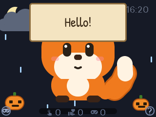

# Dashboard card

🇩🇪 [Deutsche Version](../docs_de/card.md)



A Lovelace card that runs the real Yellow in the browser: the same firmware headers (`esphome/yellow*.h`) and the same
LVGL version as on the device, compiled to WebAssembly. Touch works like on the device: tap, hold, stroke, `?` for
help, bottom-left for the games.

The card is its **own** Yellow, not a video of the device. It can follow your device's settings (character,
decoration, mood, tension, energy) and a weather entity. It does not receive commands, mail or messages and sends no
events back; a virtual Yellow that does is planned as an integration.

## Install

1. Download `yellow-card.js`, `yellow-en.js`, `yellow-en.wasm`, `yellow-de.js` and `yellow-de.wasm` from the latest
   [release](https://github.com/Ottes42/cheap-yellow-companion/releases), or build them (below).
2. Put them into one folder under `/config/www/`, e.g. `/config/www/yellow/`.
3. Settings → Dashboards → ⋮ → Resources → add `/local/yellow/yellow-card.js` as a JavaScript module. After an
   update, add `?v=2` (and so on) to the URL so browsers load the new version.
4. Add the card (YAML):

```yaml
type: custom:yellow-card
language: en                         # en or de: the texts on the screen
character: select.yellow_character   # or a fixed character: Okti, Robot or Fox
decor: select.yellow_decoration      # optional, the device's entities from here on
mood: number.yellow_mood
tension: number.yellow_tension
energy: number.yellow_energy
weather: weather.home                # optional: weather like on the device, temperature on a long press
```

Without a device, `character: Okti` alone is enough. The entity IDs depend on your device name and its language (see
[Home Assistant](homeassistant.md#entities)); selects are matched by the position of the option, so either language
works.

The card pauses while it is scrolled out of view. Several cards with the same language on one page share one Yellow.

## Build

Needs [Emscripten](https://emscripten.org/) (`emcc`), Node.js and Python 3 with `pyyaml`, `freetype-py` and
`esphome-glyphsets`:

```bash
web/build.sh        # → web/dist/
```

The script fetches LVGL and the fonts, builds the fonts from the `font:` block of `esphome/yellow-base.yaml` (same
glyphs as on the device) and one module per language in `esphome/lang/`. `web/test/snap.mjs` renders frames in Node
without a browser (e.g. `node web/test/snap.mjs out.png --kind 2 --gesture wave`), `web/test/card.html` shows the card
without Home Assistant.

How it works: `web/main.cpp` does what `yellow-base.yaml` does on the device (page, sign, fonts, touch dispatch, tick);
`web/shim/` replaces the few ESPHome functions the headers use; `web/lv_conf.h` is the configuration ESPHome generates,
adjusted for 32-bit colour.
