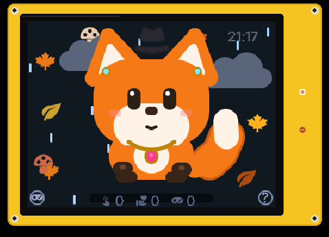
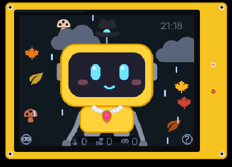
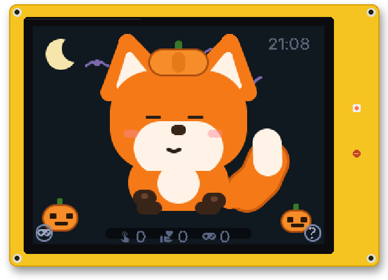
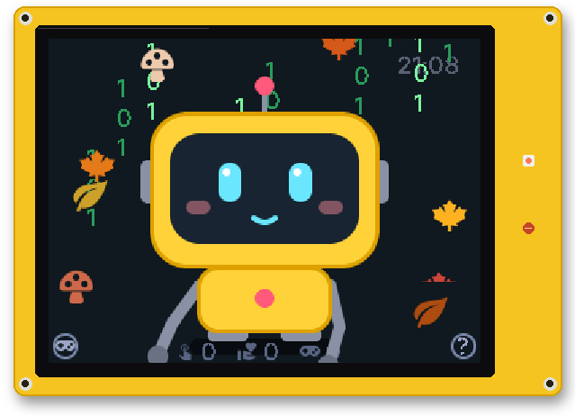
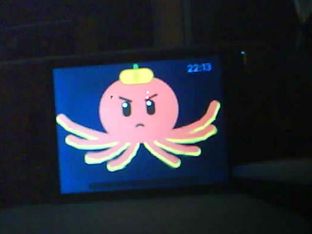

# Gallery

🇩🇪 [Deutsche Version](../docs_de/galerie.md)

A few things Yellow does. Not all of them – some are better discovered on your own desk.

## Special moves

| Okti | Fox | Robot |
|:---:|:---:|:---:|
|  |  |  |
| ink cloud (tap him four times) | the mouse dive | "Rebooting… done." |

## Every day

| | |
|:---:|:---:|
|  |  |
| He cannot talk, so he holds up cardboard. | A love letter waits until someone taps. |
|  |  |
| Weather mood | Tic-tac-toe (he cheats when losing) |

## Occasions

| | | |
|:---:|:---:|:---:|
|  |  |  |
| Christmas | Halloween | 13:37 |

## The real thing

| | |
|:---:|:---:|
|  |  |
| "2 × Post für dich!" (German build) | Mood at 100: grumpy and red |

The screenshots come from `tools/screenshot.py` (with the optional package `esphome/yellow-screenshot.yaml`) and get
their board frame from `tools/frame.py`. Most of them were taken with the German build.
